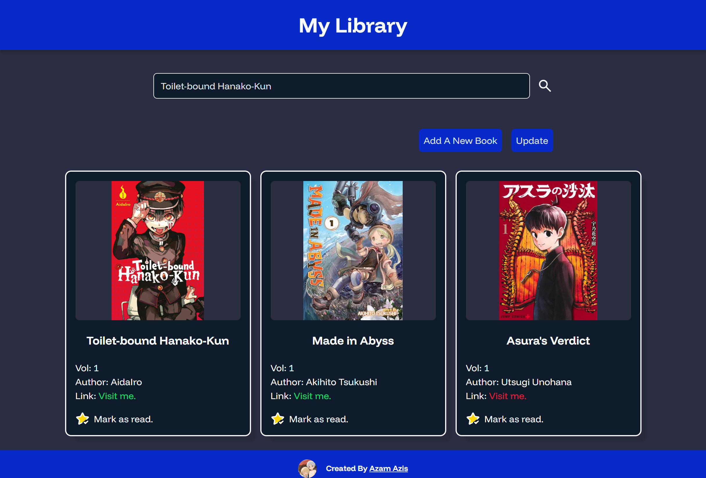

# The Odin Project - Library solution

This is a solution to the [Project: Library on The Odin Project](https://www.theodinproject.com/lessons/node-path-javascript-library).

## Table of contents

- [The Odin Project - Library solution](#the-odin-project---library-solution)
  - [Table of contents](#table-of-contents)
  - [Overview](#overview)
    - [The challenge](#the-challenge)
    - [Screenshot](#screenshot)
    - [Links](#links)
  - [My process](#my-process)
    - [Built with](#built-with)
    - [What I learned](#what-i-learned)
  - [Author](#author)
  - [Acknowledgments](#acknowledgments)

## Overview

### The challenge

Features:

- Search book(s)
- Add book(s)
- Remove book(s)
- Edit a book's information
- Change a book's read status

### Screenshot



### Links

- Live Site URL: [Add live site URL here](https://your-live-site-url.com)

## My process

### Built with

- Semantic HTML5 markup
- CSS custom properties
- Flexbox
- CSS Grid
- Mobile-first workflow

### What I learned

I learned to create object constructor.

```js
function Book(cover, title, vol, author, link, markAsRead, id) {
  if (!new.target) {
    throw Error("You must use the 'new' operator to call the constructor");
  }

  this.cover = cover;
  this.title = title;
  this.vol = vol;
  this.author = author;
  this.link = link;
  this.markAsRead = markAsRead;
  this.id = id;
}
```

## Author

- Twitter - [@AzamAzis01](https://x.com/AzamAzis01)

## Acknowledgments

- [Toilet-bound Hanako-kun Cover](https://www.amazon.com/dp/B074QTZGJ3?lv=shuf&channelId=500&plpRedirect=mhFallback)
- [Made in Abyss Cover](https://www.amazon.com/dp/1626927731?lv=shuf&channelId=500&plpRedirect=mhFallback)
- [Asuras Verdict Cover](https://www.ebay.com/itm/396332939412)
- [Hanako-kun peace sign](https://pin.it/5uCXtg4Nj)
